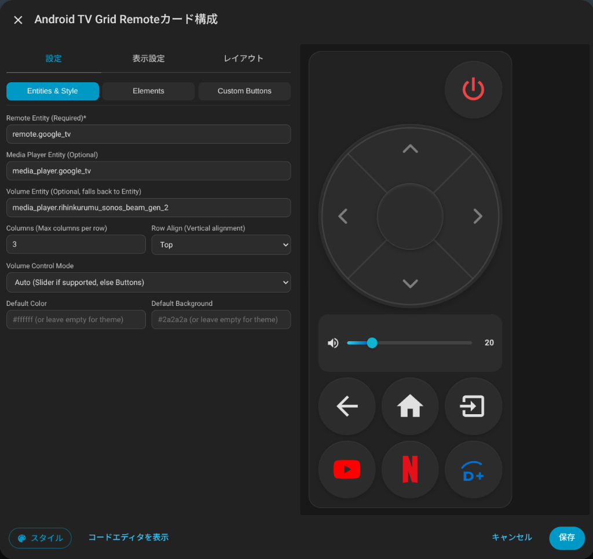
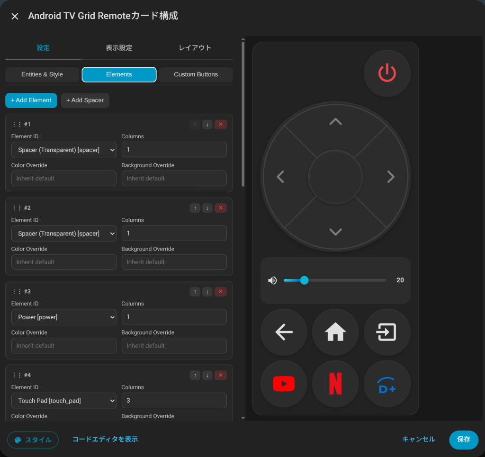
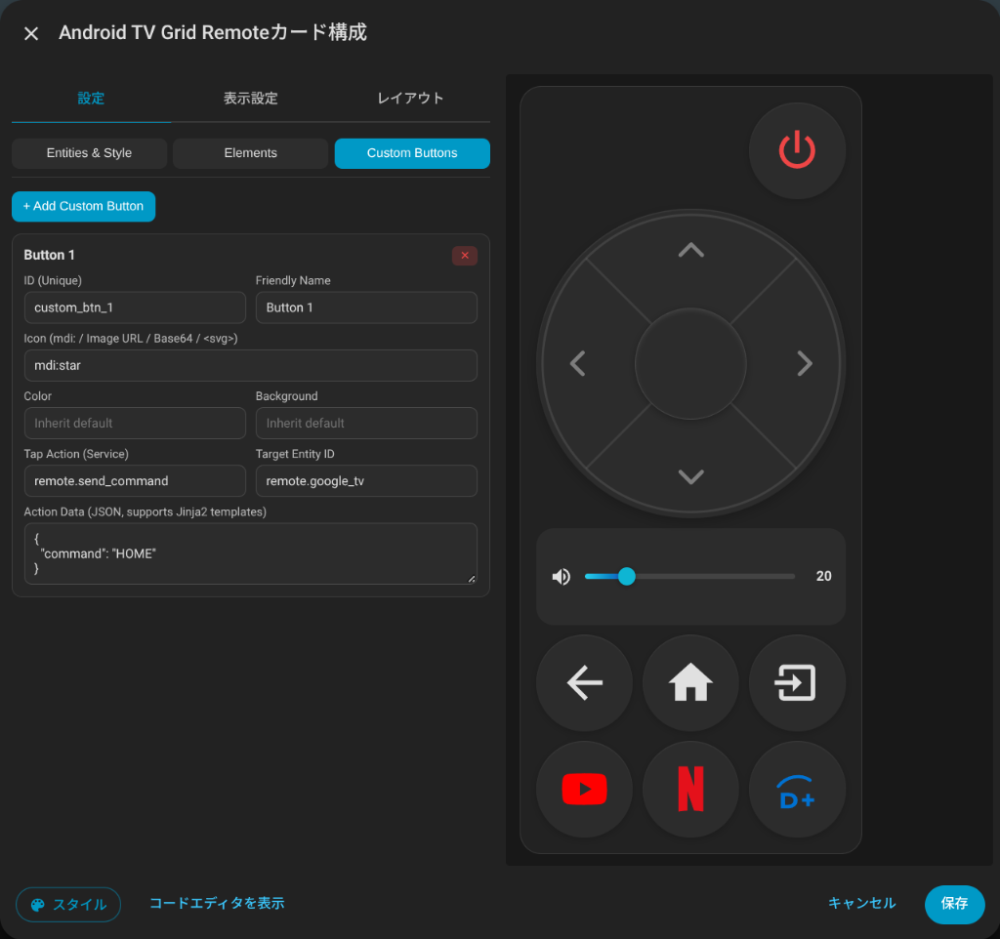

# Android TV Grid Remote

[](https://github.com/hacs/integration)
[](https://github.com/shenwii/android-tv-grid-remote/releases)
[](LICENSE)

[English](README.md) | [简体中文](README.zh-CN.md) | **日本語**

Home Assistant Lovelace 向けのモジュール式グリッド型 Android TV・ユニバーサルリモコンカードです。直感的なビジュアル UI エディタ、柔軟なグリッドレイアウト、スワイプ対応タッチパッド、スマート音量バー、オンデマンド Jinja2 テンプレート対応のカスタムボタンを備えています。

---

## スクリーンショット

| エンティティ・スタイル設定 | 要素・レイアウト配置 | カスタムボタン |
| :---: | :---: | :---: |
|  |  |  |

---

## 主な機能

- **グリッド行パッキングレイアウト**：1行の最大列数 `columns`（例：`3` や `4`）を設定し、要素を自由に配置できます。ボタン類や `touch_pad` は自動的に正方形/円形（`height = width`）を維持し、横長バー（`volume`、`media_controls`、`now_playing`）はコンパクトな 1 ユニット高さを保ちます。
- **行内の垂直配置**：同じ行に複数列ウィジェット（`2×2` や `3×3`）と `1×1` ボタンを混在させる場合、`align: top | center | bottom` で垂直方向の揃えを指定できます。
- **タッチパッド (`touch_pad`)**：5 ゾーン円形十字キー。タップ、全面スワイプジェスチャー（`touch-action: none`）、長押し連続入力に対応しています。
- **スマート音量バー (`volume`)**：`volume_entity` を使用（未指定時は `entity` にフォールバック）。`is_volume_muted` 非対応時はミュートボタンを自動非表示にし、`volume_level` 非対応時は自動的に `Mute / - / +` ボタン表示へ切り替わります（`volume_mode` で明示指定も可能）。
- **マルチフォーマットアイコン**：`mdi:`（および HA アイコンパック）、画像 URL、Base64 データ URI、インライン `<svg>`（サニタイズ済み・`currentColor` 継承）に対応。
- **カスタムボタン + オンデマンド Jinja2**：Home Assistant 標準の `tap_action` / `hold_action` / `double_tap_action` に加え、`data` 内でのオンデマンド単発 Jinja2 レンダリングに対応（常駐 WebSocket サブスクリプション不要）。
- **ビジュアル UI エディタ**：エンティティ設定、並び順変更（ドラッグ＆ドロップまたは矢印）、列幅、カラー上書き、カスタムボタンを Lovelace UI 上から直接設定できます。

---

## インストール方法

### 方法 1：HACS を使う（推奨）

1. Home Assistant で **HACS** を開きます。
2. **Frontend**（または **Dashboard**）を開き、右上の三点メニューから **Custom repositories（カスタムリポジトリ）** を選択します。
3. リポジトリ URL に `https://github.com/shenwii/android-tv-grid-remote`、カテゴリに **Dashboard**（または **Lovelace**）を指定して追加します。
4. **Android TV Grid Remote** を検索して **Download** をクリックします。
5. ブラウザのキャッシュをリロードします。

### 方法 2：手動インストール

1. [Releases ページ](https://github.com/shenwii/android-tv-grid-remote/releases) から `android-tv-grid-remote.js` をダウンロードします（またはソースから `dist/android-tv-grid-remote.js` をビルドします）。
2. `android-tv-grid-remote.js` を `<config>/www/android-tv-grid-remote.js` に配置します。
3. Home Assistant の **設定 → ダッシュボード → リソース**（右上三点メニュー）から以下を追加します：
   - **URL**：`/local/android-tv-grid-remote.js`
   - **リソースタイプ**：`JavaScript モジュール`

---

## 設定

**ビジュアル UI エディタ** または **YAML** のどちらでも設定可能です。

### カードオプション

| オプション | 型 | デフォルト | 説明 |
| :--- | :--- | :--- | :--- |
| `type` | `string` | **必須** | `custom:android-tv-grid-remote` を指定 |
| `remote_entity` | `string` | **必須** | リモコンエンティティ ID（例：`remote.google_tv`） |
| `entity` | `string` | 任意 | 再生状態・再生中情報・ソース選択用のメディアプレーヤーエンティティ ID |
| `volume_entity` | `string` | 任意 | 音量操作専用のメディアプレーヤーエンティティ ID（未指定時は `entity` を使用） |
| `columns` | `number` | `4` | 1 行あたりの最大列数 |
| `align` | `string` | `top` | 行内の垂直配置：`top`、`center`、`bottom` |
| `volume_mode` | `string` | `auto` | 音量コントロールモード：`auto`、`slider`、`buttons` |
| `color` | `string` | テーマ準拠 | デフォルトのアイコン/文字色（例：`#ffffff`） |
| `background` | `string` | テーマ準拠 | デフォルトのボタン/ウィジェット背景色（例：`#2a2a2a`） |
| `elements` | `list` | デフォルト配置 | 表示要素のリスト（`id`、`columns`、`color`、`background`） |
| `custom_buttons` | `list` | `[]` | `elements` から `id` で参照するカスタムボタン定義 |

### 組み込み要素 ID

| カテゴリ | 要素 ID |
| :--- | :--- |
| **ウィジェット** | `touch_pad`、`volume`、`media_controls`、`now_playing` |
| **ナビゲーション・システム** | `power`、`home`、`back`、`menu`、`up`、`down`、`left`、`right`、`center`、`keyboard`、`source_select`、`spacer` |
| **アプリプリセット** | `youtube`、`netflix`、`disney_plus`、`prime_video` |

### YAML 設定例

```yaml
type: custom:android-tv-grid-remote
remote_entity: remote.google_tv
entity: media_player.google_tv
volume_entity: media_player.sonos_beam_gen_2
columns: 3
align: top
volume_mode: auto
elements:
  - id: spacer
    columns: 1
  - id: spacer
    columns: 1
  - id: power
    columns: 1
    color: "#ff5252"
  - id: touch_pad
    columns: 3
  - id: volume
    columns: 3
  - id: back
    columns: 1
  - id: home
    columns: 1
  - id: source_select
    columns: 1
  - id: youtube
    columns: 1
  - id: netflix
    columns: 1
  - id: disney_plus
    columns: 1
  - id: my_custom_btn
    columns: 1
custom_buttons:
  - id: my_custom_btn
    friendly_name: Launch App
    icon: mdi:star
    color: "#ffffff"
    background: "#1f6feb"
    tap_action:
      action: perform-action
      perform_action: media_player.select_source
      target:
        entity_id: media_player.google_tv
      data:
        source: "{{ 'Netflix' }}"
```

---

## 開発・ビルド

```bash
npm install
npm run build
```

ビルドされたバンドルは `dist/android-tv-grid-remote.js` に出力されます。

## ライセンス

このプロジェクトは [MIT License](LICENSE) の下で公開されています。
