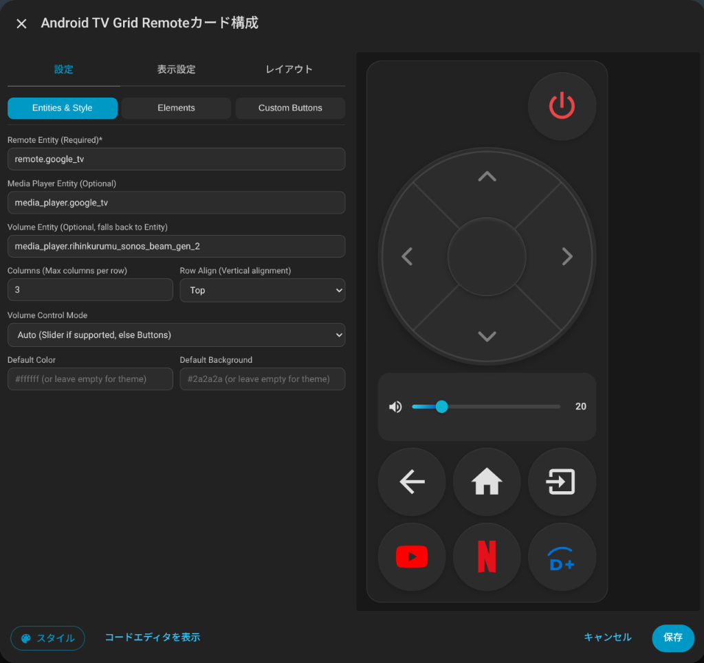
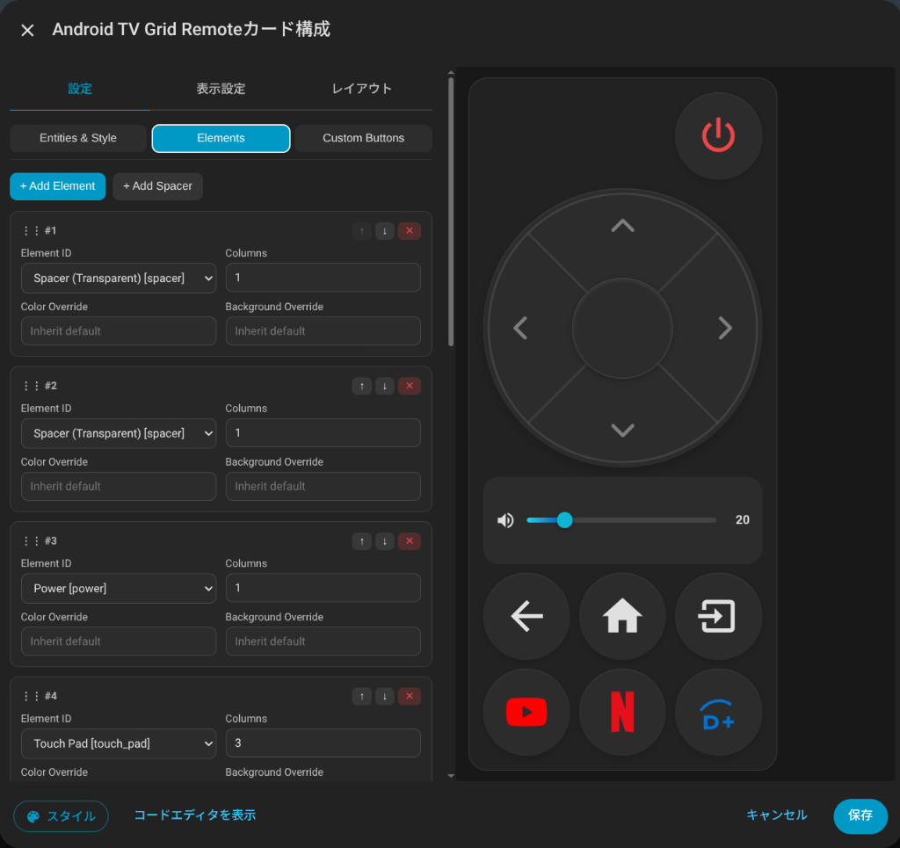
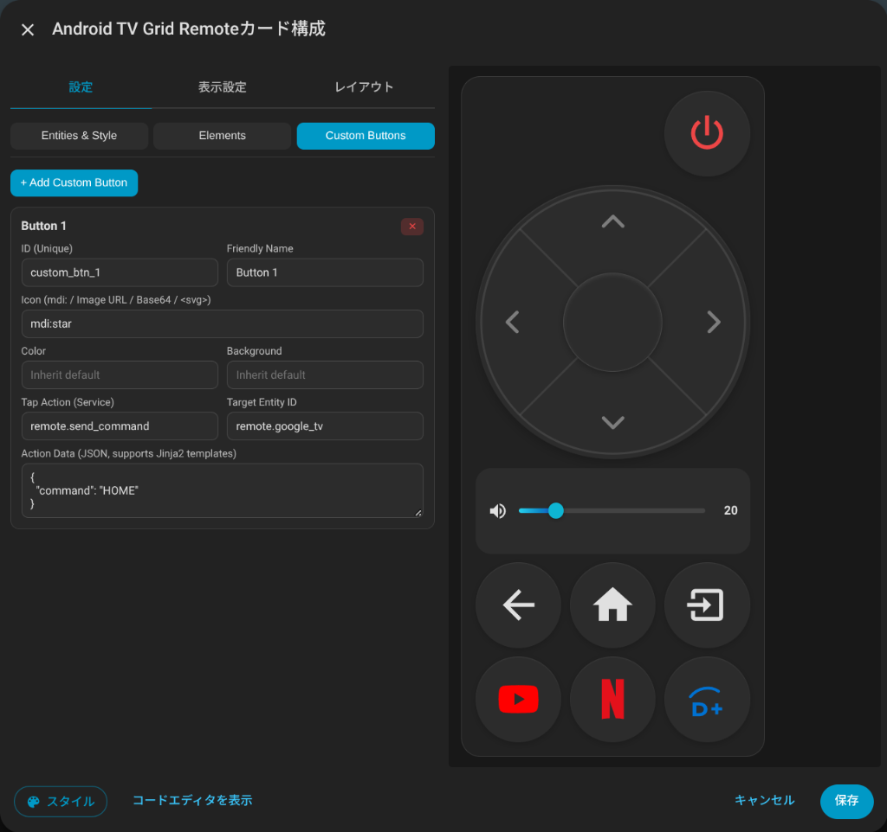

# Android TV Grid Remote

[](https://github.com/hacs/integration)
[](https://github.com/shenwii/android-tv-grid-remote/releases)
[](LICENSE)

**English** | [简体中文](README.zh-CN.md) | [日本語](README.ja.md)

A modular, grid-based Android TV & universal remote card for Home Assistant Lovelace, featuring a full Visual UI Editor, responsive row-packing grid layout, swipeable D-Pad, smart volume bar, and custom buttons with on-demand Jinja2 templating.

---

## Screenshots

| Entities & Style | Elements & Layout | Custom Buttons |
| :---: | :---: | :---: |
|  |  |  |

---

## Features

- **Grid Row-Packing Layout**: Configure `columns` (e.g., `3` or `4`) and arrange elements freely. Square/circular elements & `touch_pad` automatically maintain `height = width`, while horizontal bars (`volume`, `media_controls`, `now_playing`) stay a compact 1-unit height.
- **Row Vertical Alignment**: `align: top | center | bottom` when mixing multi-column widgets (like `2×2` or `3×3`) with `1×1` buttons in the same row.
- **Touch Pad (`touch_pad`)**: Circular 5-zone D-Pad with click, full-area swipe gestures (`touch-action: none`), and hold-to-repeat navigation.
- **Smart Volume Bar (`volume`)**: Uses `volume_entity` (falls back to `entity`), auto-hides the mute button if `is_volume_muted` is unsupported, and auto-falls back to `Mute / - / +` buttons when absolute `volume_level` is unsupported (or force via `volume_mode`).
- **Multi-Format Icons**: Supports `mdi:` (and Home Assistant icon packs), image URLs, Base64 data URIs, and inline `<svg>` (sanitized with `currentColor` inheritance).
- **Custom Buttons + On-Demand Jinja2**: Standard Home Assistant `tap_action` / `hold_action` / `double_tap_action`, with on-demand one-shot Jinja2 rendering inside `data` (zero lingering WebSocket subscriptions).
- **Visual UI Editor**: Configure entities, layout order (drag & drop or arrows), column spans, color overrides, and custom buttons directly from the Lovelace UI.

---

## Installation

### Option 1: HACS (Recommended)

1. Open **HACS** in your Home Assistant instance.
2. Go to **Frontend** (or **Dashboard**), click the three-dot menu in the top right, and select **Custom repositories**.
3. Add `https://github.com/shenwii/android-tv-grid-remote` with category **Dashboard** (or **Lovelace**).
4. Search for **Android TV Grid Remote** and click **Download**.
5. Refresh your browser cache.

### Option 2: Manual Installation

1. Download `android-tv-grid-remote.js` from the [latest release](https://github.com/shenwii/android-tv-grid-remote/releases) (or build from source into `dist/android-tv-grid-remote.js`).
2. Copy `android-tv-grid-remote.js` to `<config>/www/android-tv-grid-remote.js`.
3. In Home Assistant, go to **Settings → Dashboards → Resources** (three-dot menu in the top right) and add:
   - **URL**: `/local/android-tv-grid-remote.js`
   - **Resource type**: `JavaScript Module`

---

## Configuration

You can configure the card completely via the **Visual UI Editor** or in **YAML**.

### Card Options

| Option | Type | Default | Description |
| :--- | :--- | :--- | :--- |
| `type` | `string` | **Required** | Must be `custom:android-tv-grid-remote` |
| `remote_entity` | `string` | **Required** | Remote entity ID (e.g., `remote.google_tv`) |
| `entity` | `string` | Optional | Media player entity ID for playback state, Now Playing & source selection |
| `volume_entity` | `string` | Optional | Separate media player entity ID for volume control (falls back to `entity`) |
| `columns` | `number` | `4` | Maximum number of columns per row |
| `align` | `string` | `top` | Vertical alignment within a row: `top`, `center`, or `bottom` |
| `volume_mode` | `string` | `auto` | Volume control mode: `auto`, `slider`, or `buttons` |
| `color` | `string` | Theme default | Default icon/text color (e.g., `#ffffff`) |
| `background` | `string` | Theme default | Default button/widget background color (e.g., `#2a2a2a`) |
| `elements` | `list` | Default layout | Ordered list of elements (`id`, `columns`, `color`, `background`) |
| `custom_buttons` | `list` | `[]` | Definitions for custom buttons referenced by `id` in `elements` |

### Built-in Elements

| Category | Element IDs |
| :--- | :--- |
| **Widgets** | `touch_pad`, `volume`, `media_controls`, `now_playing` |
| **Navigation & System** | `power`, `home`, `back`, `menu`, `up`, `down`, `left`, `right`, `center`, `keyboard`, `source_select`, `spacer` |
| **App Presets** | `youtube`, `netflix`, `disney_plus`, `prime_video` |

### YAML Example

```yaml
type: custom:android-tv-grid-remote
remote_entity: remote.google_tv
entity: media_player.google_tv
volume_entity: media_player.sonos_beam_gen_2
columns: 3
align: top
volume_mode: auto
elements:
  - id: spacer
    columns: 1
  - id: spacer
    columns: 1
  - id: power
    columns: 1
    color: "#ff5252"
  - id: touch_pad
    columns: 3
  - id: volume
    columns: 3
  - id: back
    columns: 1
  - id: home
    columns: 1
  - id: source_select
    columns: 1
  - id: youtube
    columns: 1
  - id: netflix
    columns: 1
  - id: disney_plus
    columns: 1
  - id: my_custom_btn
    columns: 1
custom_buttons:
  - id: my_custom_btn
    friendly_name: Launch App
    icon: mdi:star
    color: "#ffffff"
    background: "#1f6feb"
    tap_action:
      action: perform-action
      perform_action: media_player.select_source
      target:
        entity_id: media_player.google_tv
      data:
        source: "{{ 'Netflix' }}"
```

---

## Development & Build

```bash
npm install
npm run build
```

The compiled bundle is output to `dist/android-tv-grid-remote.js`.

## License

This project is licensed under the [MIT License](LICENSE).
