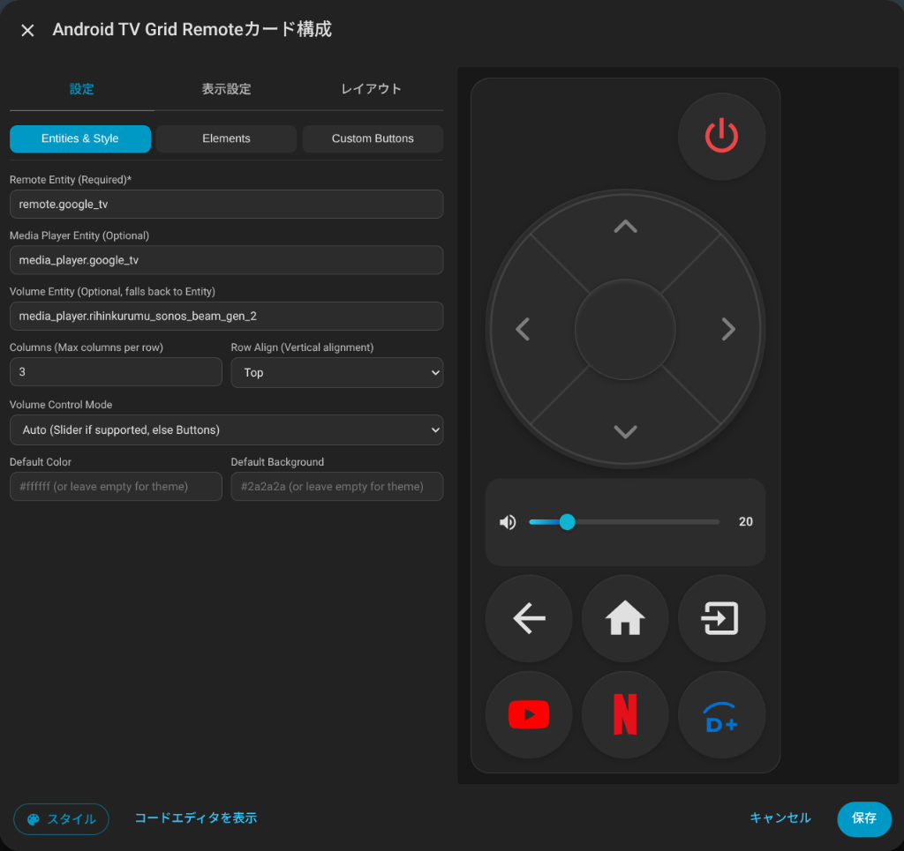
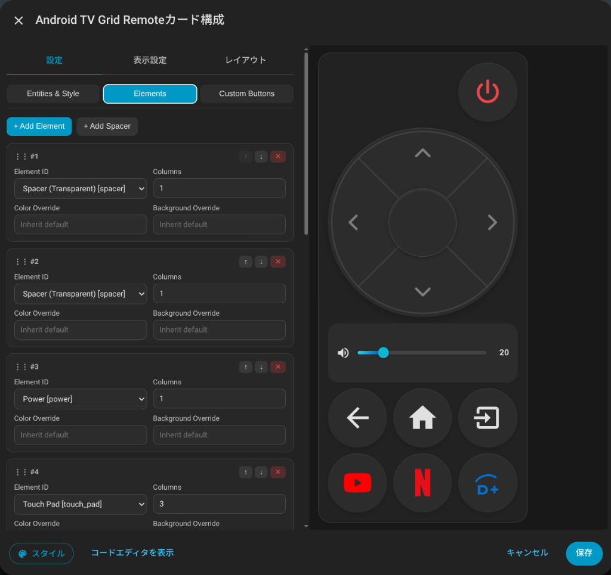
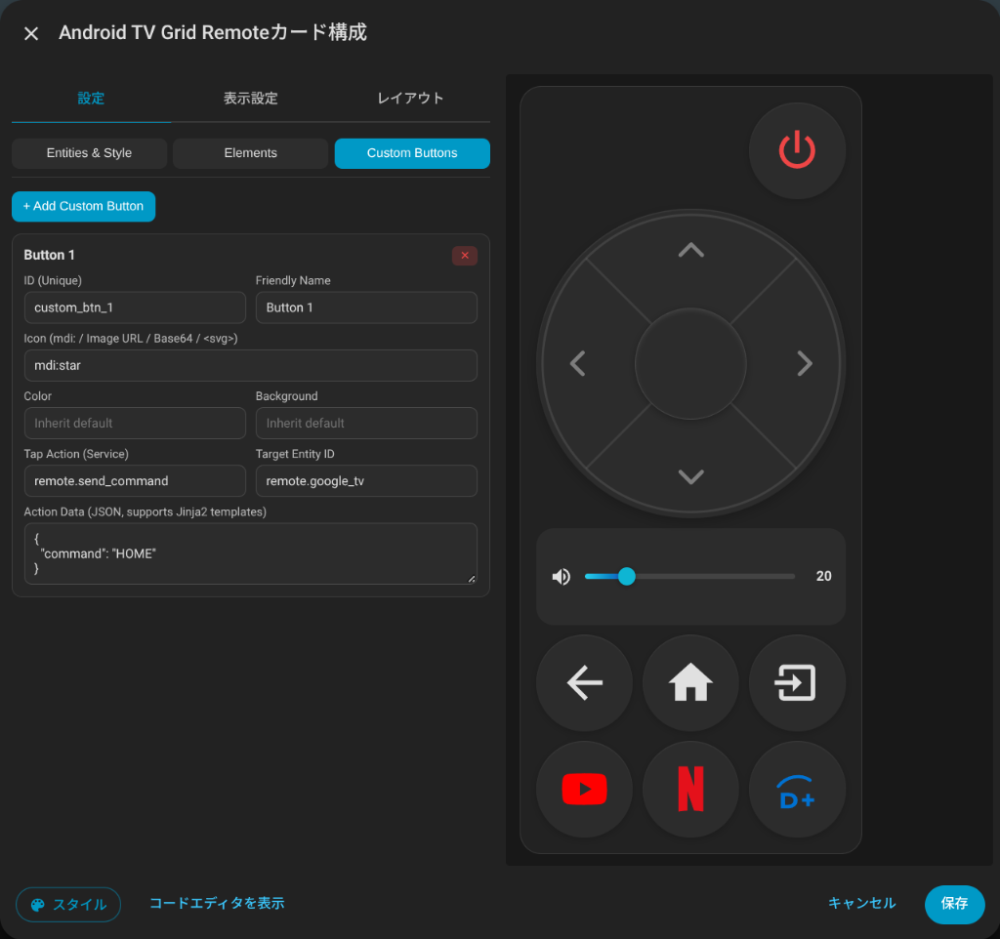

# Android TV Grid Remote

[](https://github.com/hacs/integration)
[](https://github.com/shenwii/android-tv-grid-remote/releases)
[](LICENSE)

[English](README.md) | **简体中文** | [日本語](README.ja.md)

一款用于 Home Assistant Lovelace 的模块化、网格布局 Android TV 及通用遥控器卡片。提供完整的可视化 UI 编辑器、自适应网格行排列、支持滑动的圆形触摸板、智能音量条，以及支持按需 Jinja2 模板渲染的自定义按钮。

---

## 界面预览

| 实体与样式设置 | 元素与布局编排 | 自定义按钮 |
| :---: | :---: | :---: |
|  |  |  |

---

## 功能特性

- **网格行排列布局**：自由配置每行列数 `columns`（如 `3` 或 `4`）并编排元素。按钮类元素与 `touch_pad` 自动保持等宽高（正方形/圆形），横向长条组件（`volume`、`media_controls`、`now_playing`）则保持紧凑的 1 单位高度。
- **行内垂直对齐**：当同一行混排多列组件（如 `2×2`、`3×3`）与 `1×1` 按钮时，可通过 `align: top | center | bottom` 控制垂直对齐方式。
- **圆形触摸板 (`touch_pad`)**：5 区域圆形方向键，支持点击、全区域滑动手势（`touch-action: none`）及长按连续触发。
- **智能音量条 (`volume`)**：支持独立的 `volume_entity`（未配置时回退至 `entity`）。当实体不支持 `is_volume_muted` 时自动隐藏静音按钮；当不支持绝对音量 `volume_level` 时自动切换为 `静音 / - / +` 按钮模式（也可通过 `volume_mode` 强制指定）。
- **多格式图标支持**：支持 `mdi:`（及 Home Assistant 图标包）、图片 URL、Base64 Data URI 以及内联 `<svg>`（自动安全过滤并继承 `currentColor`）。
- **自定义按钮 + 按需 Jinja2 渲染**：完整支持 Home Assistant 标准 `tap_action` / `hold_action` / `double_tap_action`，支持在 `data` 中按需单次渲染 Jinja2 模板（无常驻 WebSocket 订阅开销）。
- **可视化 UI 编辑器**：直接在 Lovelace 界面中配置实体、拖拽或箭头调整元素顺序、设置列跨度、覆盖颜色以及管理自定义按钮。

---

## 安装方法

### 方式一：通过 HACS 安装（推荐）

1. 在 Home Assistant 中打开 **HACS**。
2. 进入 **前端（Frontend / Dashboard）**，点击右上角三点菜单，选择 **自定义存储库（Custom repositories）**。
3. 添加仓库地址 `https://github.com/shenwii/android-tv-grid-remote`，类别选择 **Dashboard**（或 **Lovelace**）。
4. 搜索 **Android TV Grid Remote** 并点击 **下载**。
5. 刷新浏览器缓存即可使用。

### 方式二：手动安装

1. 从 [Releases 页面](https://github.com/shenwii/android-tv-grid-remote/releases) 下载 `android-tv-grid-remote.js`（或自行编译生成 `dist/android-tv-grid-remote.js`）。
2. 将 `android-tv-grid-remote.js` 复制到 `<config>/www/android-tv-grid-remote.js`。
3. 在 Home Assistant 中进入 **设置 → 仪表盘 → 资源**（右上角三点菜单），添加资源：
   - **URL**：`/local/android-tv-grid-remote.js`
   - **资源类型**：`JavaScript 模块`

---

## 配置说明

支持通过 **可视化 UI 编辑器** 或 **YAML** 进行完整配置。

### 卡片参数

| 参数 | 类型 | 默认值 | 说明 |
| :--- | :--- | :--- | :--- |
| `type` | `string` | **必填** | 固定为 `custom:android-tv-grid-remote` |
| `remote_entity` | `string` | **必填** | 遥控器实体 ID（如 `remote.google_tv`） |
| `entity` | `string` | 可选 | 媒体播放器实体 ID，用于播放状态、正在播放信息及信源切换 |
| `volume_entity` | `string` | 可选 | 独立的音量控制实体 ID（未填时回退至 `entity`） |
| `columns` | `number` | `4` | 每行最大列数 |
| `align` | `string` | `top` | 行内垂直对齐方式：`top`、`center` 或 `bottom` |
| `volume_mode` | `string` | `auto` | 音量控制模式：`auto`（自动）、`slider`（滑块）或 `buttons`（按钮） |
| `color` | `string` | 跟随主题 | 默认图标/文字颜色（如 `#ffffff`） |
| `background` | `string` | 跟随主题 | 默认按钮/组件背景色（如 `#2a2a2a`） |
| `elements` | `list` | 默认布局 | 按顺序排列的元素列表（支持 `id`、`columns`、`color`、`background`） |
| `custom_buttons` | `list` | `[]` | 自定义按钮定义，可在 `elements` 中通过 `id` 引用 |

### 内置元素 ID

| 分类 | 元素 ID |
| :--- | :--- |
| **功能组件** | `touch_pad`、`volume`、`media_controls`、`now_playing` |
| **导航与系统** | `power`、`home`、`back`、`menu`、`up`、`down`、`left`、`right`、`center`、`keyboard`、`source_select`、`spacer` |
| **流媒体快捷方式** | `youtube`、`netflix`、`disney_plus`、`prime_video` |

### YAML 配置示例

```yaml
type: custom:android-tv-grid-remote
remote_entity: remote.google_tv
entity: media_player.google_tv
volume_entity: media_player.sonos_beam_gen_2
columns: 3
align: top
volume_mode: auto
elements:
  - id: spacer
    columns: 1
  - id: spacer
    columns: 1
  - id: power
    columns: 1
    color: "#ff5252"
  - id: touch_pad
    columns: 3
  - id: volume
    columns: 3
  - id: back
    columns: 1
  - id: home
    columns: 1
  - id: source_select
    columns: 1
  - id: youtube
    columns: 1
  - id: netflix
    columns: 1
  - id: disney_plus
    columns: 1
  - id: my_custom_btn
    columns: 1
custom_buttons:
  - id: my_custom_btn
    friendly_name: Launch App
    icon: mdi:star
    color: "#ffffff"
    background: "#1f6feb"
    tap_action:
      action: perform-action
      perform_action: media_player.select_source
      target:
        entity_id: media_player.google_tv
      data:
        source: "{{ 'Netflix' }}"
```

---

## 本地构建

```bash
npm install
npm run build
```

编译产物将输出至 `dist/android-tv-grid-remote.js`。

## 开源协议

本项目基于 [MIT License](LICENSE) 开源。
